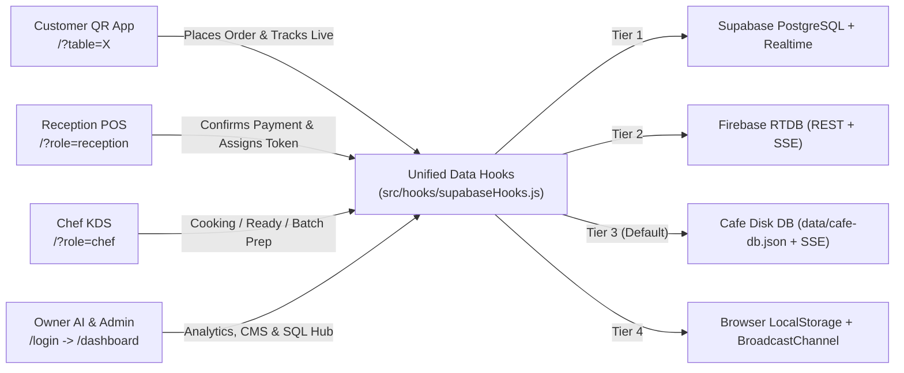

<div align="center">


# ☕ Chatter & Platter Cafe — AI Smart Cafe OS

**An open-source, mobile-first QR ordering PWA, Reception POS, Kitchen Display System (KDS), and AI Business Intelligence suite built for modern cafes.**

[](./LICENSE)
[](https://react.dev/)
[](https://vite.dev/)
[](https://tailwindcss.com/)
[](./supabase_schema.sql)
[](./vite.config.js)

[Quick Start](#-60-second-quick-start) •
[Features](#-core-features--ai-intelligence) •
[Architecture](#-system-architecture) •
[Free Database Setup](#-4-tier-free-database-architecture) •
[Routes](#-routes--roles) •
[Contributing](./CONTRIBUTING.md) •
[Security](./SECURITY.md)

</div>

---

## ✨ Why Chatter & Platter?

Most cafe POS tools are expensive, locked to proprietary hardware, or require cloud subscriptions before you can even test them. **Chatter & Platter Cafe OS** gives independent cafes and college food spots an end-to-end digital dining workflow that **runs immediately out of the box for ₹0**:

- **Zero mandatory cloud setup** — starts with a built-in real-time persistent disk database (`data/cafe-db.json` + Server-Sent Events) that syncs customer phones, reception tablets, and kitchen screens over local cafe Wi-Fi.
- **Scales cleanly to free cloud tiers** — plug in **Firebase Realtime Database (Spark Plan)** or restore **Supabase PostgreSQL** in under 2 minutes with [`supabase_schema.sql`](./supabase_schema.sql).
- **On-device AI Smart Engine** — craving recommendations, dynamic prep-time prediction, natural-language walk-in order parsing, kitchen batch-prep aggregation, sentiment analysis, and interactive owner Q&A without external LLM API keys or latency.

---

## 🚀 Core Features & AI Intelligence

### 1. 👤 Customer QR Ordering App (`/?table=X`)
Designed as a crisp mobile-first PWA (`max-w-[430px]` centered frame on desktop) with smooth Framer Motion transitions:
- **Chatter AI Barista (`AICravingsDrawer`)**: Natural-language dish discovery (e.g., *"spicy under 80"*, *"cheesy"*), time-of-day contextual recommendations, mood presets (*Rainy Chai & Snacks*, *Study Fuel*, *Beat the Heat*), and **1-tap Smart Combos**.
- **Smart Menu Browser**: Instant search, Veg-only filter, category tabs (`HOT`, `COLD`, `MOMO`, `FRIES`, `PASTA`, `MAGGI`, `SANDWICH`), Indian Veg/Egg/Non-Veg indicators, prep-time badges, and live kitchen wait ETA.
- **Smart Tray & Checkout**: AI-suggested food/drink pairings (*"Frequently Paired With"*), swipe-to-remove gestures, cooking preference chips (*Less Spicy*, *Piping Hot*, *Less Sugar*, *No Onion*), and Cash / Online UPI selection.
- **Hero Live Order Tracker**: Massive token number display (`#1–99`), real-time step timeline with timestamps, mute/unmute Web Audio chimes, haptic vibration, browser notifications, and a fullscreen **`TOKEN #X IS READY!`** celebration alert.
- **Smart Feedback**: Interactive 5-star rating with quick experience tags and automatic sentiment tagging (`positive` / `neutral` / `negative`).

### 2. 🛎️ Reception POS & Order Desk (`/?role=reception` or `/login`)
- **AI Quick-Order Parser**: Type natural language like `"2 masala tea, 1 veg momo table 4"` in the walk-in modal to automatically match menu items, quantities, and table numbers.
- **Real-Time Payment Queue**: Live elapsed timers, payment method badges, inline order editing, safe confirmation modals (no full-page reloads), and atomic **1–99 Token Assignment**.
- **Active Orders Command View**: Segmented filters (`All | Queued | Cooking | Ready`), search by token/table/guest name, live today stats, and estimated kitchen wait badge.

### 3. 👨‍🍳 Chef Kitchen Display System (`/?role=chef` or `/login`)
- **3-Column Dark High-Contrast Kanban Board**: `New Orders` → `Cooking` → `Ready` with single-tap advancement and instant `Undo` (responsive tabbed layout on mobile tablets).
- **AI Batch Prep Bar**: Aggregates total item quantities across all active tickets (e.g., `4× Veg Maggi • 3× Kulhad Tea`) so chefs can batch-cook efficiently.
- **Kitchen Rush Mode & Timers**: Toggle **Rush Mode** to automatically adjust customer ETAs across the cafe, color-coded elapsed prep timers (amber ≥8m, pulsing red ≥12m), special instruction highlights, fullscreen toggle, and queued audio alerts for background tabs.

### 4. 📊 Owner AI Business Intelligence Hub (`/login` → Owner)
- **Ask Chatter AI Analyst**: Interactive Q&A bar grounded in live cafe metrics (*"What are top sellers?"*, *"Cash vs Online split?"*, *"Average prep speed?"*).
- **Executive Analytics**: Today / Month / Year revenue cards with Cash vs Online breakdown, hourly stacked sales chart (`Recharts`), Top Sellers leaderboard, automated insight cards, and customer sentiment feed.
- **Formula-Safe CSV Export & Stock Control**: Download sanitized CSV reports and toggle item availability in real time.

### 5. 🛠️ Admin System & Schema Console (`/login` → Admin)
- **Database Connection Inspector**: Shows active backend engine, probe latency, and mode switching.
- **Built-in SQL Schema Viewer**: Inspect and 1-click copy [`supabase_schema.sql`](./supabase_schema.sql) right from the browser.
- **Menu CMS & Dev Logs**: Add custom dishes with prep times, delete items, sync the 38-item starter catalog, inspect staff roles, and view captured runtime error logs.

---

## 🧩 System Architecture



---

## ⚡ 60-Second Quick Start

### Prerequisites
- **Node.js 18+** and **npm**

### Run Locally (Multi-Device Cafe Wi-Fi Ready)

```bash
# 1. Clone the repository
git clone https://github.com/Abhishek11hub987/Project_Chatter-Platter.git
cd Project_Chatter-Platter

# 2. Install dependencies
npm install

# 3. Start the app + built-in real-time disk database (exposed on LAN)
npm run dev:host
```

Open any role directly in your browser (or scan from phones on the same Wi-Fi network):

| Role / Screen | URL | Default Dev Credentials |
| :--- | :--- | :--- |
| **Customer QR Menu** | `http://localhost:5173/?table=5` | No login required |
| **Interactive Role Explorer & Staff Login** | `http://localhost:5173/login` | 1-click Demo cards in local mode |
| **Reception POS Terminal** | `http://localhost:5173/?role=reception` | PIN `1234` (`VITE_RECEPTION_PIN`) |
| **Chef Kitchen Display** | `http://localhost:5173/?role=chef` | PIN `5678` (`VITE_CHEF_PIN`) |

---

## 🗄️ 4-Tier Free Database Architecture

[`supabaseHooks.js`](./src/hooks/supabaseHooks.js) automatically selects the highest-priority active database without requiring manual code edits:

| Priority | Backend Engine | Persistence & Sync | Setup Needed |
| :---: | :--- | :--- | :--- |
| **1** | **Supabase PostgreSQL** | Cloud Postgres + Realtime + Auth + RPC | Add `VITE_SUPABASE_URL` & `VITE_SUPABASE_ANON_KEY`, run [`supabase_schema.sql`](./supabase_schema.sql) |
| **2** | **Firebase Realtime DB** | Free Spark cloud JSON + SSE (`EventSource`) | Add `VITE_FIREBASE_DB_URL` to `.env.local` |
| **3** | **Built-in Cafe Disk DB** | Saves to `data/cafe-db.json` + SSE (`/api/events`) | **None** — active automatically during `npm run dev` / `npm run dev:host` |
| **4** | **Browser Local Mode** | `localStorage` + `BroadcastChannel` | **None** — automatic static fallback |

### Restoring / Setting Up Supabase (Recommended for Internet Hosting)
1. Create a free project at [supabase.com](https://supabase.com/dashboard).
2. Open **SQL Editor → New Query**, paste [`supabase_schema.sql`](./supabase_schema.sql), and click **Run**.
   - Creates `menu`, `orders`, `feedbacks`, `user_roles`, and `cafe_settings`.
   - Configures indexes, RLS policies, Realtime replication, atomic `approve_order_with_token` RPC, and seeds all **38 cafe items**.
3. Copy [`.env.example`](./.env.example) to `.env.local` and paste your Supabase Project URL and Anon Key.
4. Create staff accounts under **Authentication → Users** and assign roles using the SQL snippet at the bottom of [`supabase_schema.sql`](./supabase_schema.sql).

### Using Firebase Realtime Database (Free Cloud Alternative for Vercel)
If you want a zero-pause free cloud database for static hosting on Vercel:
1. Create a project in [Firebase Console](https://console.firebase.google.com/) (Spark Plan) and enable **Realtime Database**.
2. Set `VITE_FIREBASE_DB_URL=https://your-project-default-rtdb.firebaseio.com` in `.env.local` (and in Vercel Environment Variables).

---

## 🔐 Environment Variables

Copy [`.env.example`](./.env.example) to `.env.local`:

```env
# Option A: Supabase
VITE_SUPABASE_URL=
VITE_SUPABASE_ANON_KEY=

# Option B: Firebase Realtime Database (Free Spark Plan)
VITE_FIREBASE_DB_URL=

# Staff Terminal PINs (change before public deployment!)
VITE_RECEPTION_PIN=1234
VITE_CHEF_PIN=5678
```

---

## 📁 Project Structure

```text
chatter-platter-cafe/
├── .github/                  # Issue & PR templates
├── public/                   # PWA manifest, icons, and food category photography
├── server/
│   └── cafeDbPlugin.js       # Zero-dependency REST + SSE + atomic JSON disk DB server
├── src/
│   ├── components/
│   │   ├── AICravingsDrawer.jsx   # Chatter AI Barista natural-language recommendation drawer
│   │   ├── CRMOrderModal.jsx      # Walk-in POS modal with AI natural-language parser
│   │   ├── CartBar.jsx            # Floating bottom tray summary + live ETA
│   │   ├── ErrorBoundary.jsx      # Resilient React error boundary
│   │   └── MenuCard.jsx           # Veg/Egg/Non-Veg indicator, prep badge & stepper card
│   ├── data/
│   │   ├── diskDbClient.js        # /api/* + SSE client for Built-in Cafe Disk DB
│   │   ├── firebaseRtdbClient.js  # Zero-SDK REST + SSE Firebase Realtime DB adapter
│   │   ├── localDemoEngine.js     # Browser LocalStorage + BroadcastChannel sync engine
│   │   ├── menuData.js            # 38-item catalog with tags, descriptions & prep times
│   │   └── seedMenu.js            # Upsert helper for seeding Supabase/local menu
│   ├── hooks/
│   │   ├── supabaseHooks.js       # Unified 4-tier database hooks (auth, menu, orders, settings)
│   │   └── useSound.js            # Web Audio API chimes & kitchen alert synthesizer
│   ├── pages/
│   │   ├── Customer/              # Welcome, Menu, Cart, Tracker, Feedback screens
│   │   ├── AdminApp.jsx           # Health checks, SQL Schema copy viewer, Menu CMS, Logs
│   │   ├── ChefApp.jsx            # Dark KDS Kanban board + AI Batch Prep Bar + Rush Mode
│   │   ├── CustomerApp.jsx        # Mobile-frame router + splash screen
│   │   ├── Dashboard.jsx          # Authenticated staff shell + multi-role view switcher
│   │   ├── Login.jsx              # Staff Auth + Interactive Role Explorer
│   │   ├── OwnerApp.jsx           # AI Business Intelligence, Recharts & CSV export
│   │   └── ReceptionApp.jsx       # Live pending queue, token generator & active order desk
│   ├── store/useStore.js          # Persisted Zustand cart, table, notes & sound state
│   └── utils/smartCafeAI.js       # On-device AI engine (recommendations, ETA, BI, parser)
├── tests/app.spec.js         # Playwright end-to-end cafe workflow spec
├── supabase_schema.sql       # Complete idempotent Supabase PostgreSQL schema + seed
├── CONTRIBUTING.md           # Contributor setup & code quality guidelines
├── SECURITY.md               # Production hardening & RLS security checklist
└── LICENSE                   # MIT License
```

---

## 🛠️ Available Scripts

| Command | Description |
| :--- | :--- |
| `npm run dev` | Start Vite dev server with built-in Cafe Disk DB (`localhost:5173`) |
| `npm run dev:host` | Expose dev server & Cafe Disk DB on your local Wi-Fi network |
| `npm run server` | Run the Cafe Disk DB server standalone (`PORT=4000` by default) |
| `npm run build` | Build production PWA bundle & Workbox service worker into `dist/` |
| `npm run preview` | Preview production build locally with Cafe Disk DB middleware |
| `npm run lint` | Run static analysis across `src/` and `server/` using `oxlint` |
| `npm run format` | Format `src/` with Prettier |
| `npm run test:e2e` | Run Playwright end-to-end tests |

---

## 🛡️ Security & Production Readiness

Before deploying publicly, review [`SECURITY.md`](./SECURITY.md):
- Never commit `.env.local` or `data/` (both ignored via [`.gitignore`](./.gitignore)).
- Override `VITE_RECEPTION_PIN` and `VITE_CHEF_PIN` in production environments.
- Tighten Supabase Row-Level Security (RLS) policies in [`supabase_schema.sql`](./supabase_schema.sql) to require `public.is_staff()` for staff mutations.

---

## 🤝 Contributing

Contributions, issues, and feature requests are welcome! Please read [`CONTRIBUTING.md`](./CONTRIBUTING.md) before opening a pull request.

## 📄 License

Distributed under the **MIT License**. See [`LICENSE`](./LICENSE) for full details.
